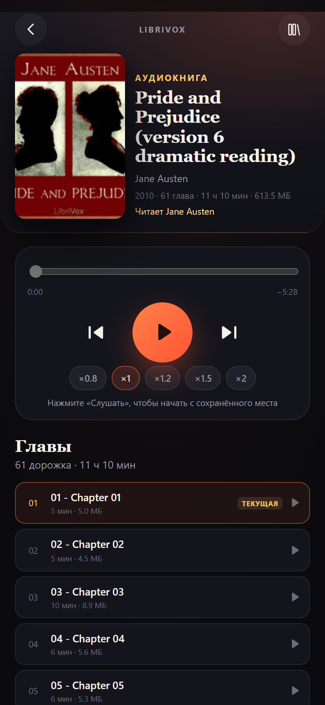

# Полка — книги и аудиокниги на телефоне

Мобильное приложение для чтения и прослушивания книг: **поиск по реальным открытым библиотекам**, скачивание файлов прямо в приложение, офлайн-чтение, аудиокниги, персональные рекомендации и цели по чтению.


---

## 1. Мульти-источниковый каталог

Приложение ищет книги сразу в нескольких официальных каталогах и объединяет результаты в одну выдачу с удалением дублей.

| Источник | Что даёт | Статус |
|---|---|---|
| **Open Library** (`openlibrary.org`) | метаданные, обложки, ISBN, жанры, новинки, тренды | работает (CORS открыт) |
| **Internet Archive** (`archive.org`) | реальные файлы EPUB/PDF/TXT для материалов в открытом доступе | работает |
| **Project Gutenberg** | общественное достояние — через официальную коллекцию `collection:gutenberg` в Internet Archive | работает (gutenberg.org напрямую недоступен из этой сети: 503) |
| **LibriVox** | аудиокниги общественного достояния (MP3, официальное зеркало в IA) | работает |
| **Google Books** | метаданные, превью, покупка | требует API-ключ: без него Google отвечает 429 «Quota exceeded» |
| **Полка** (встроенная) | 14 полных текстов из Викитеки | работает офлайн, без сети |

Что умеет каталог:

- **Поиск** по названию, автору, ISBN и жанру сразу по всем включённым источникам (`src/catalog/aggregate.ts`), с отменой устаревших запросов.
- **Объединение и дедупликация**: книги сопоставляются по ISBN и похожести названия/автора, данные сливаются (обложка, описание, форматы, доступ), а не дублируются.
- **Ранжирование по релевантности**: совпадения в названии и авторе весят больше, скачиваемые книги поднимаются выше.
- **Новинки и популярное**: тренды Open Library, свежие издания, классика LibriVox и Gutenberg; витрины чередуют источники, чтобы одна библиотека не занимала весь список.
- **Жанры**: подборки по темам (`subjects`).
- **Кэш** (IndexedDB `polka-catalog`): выдача поиска 15 минут, витрины 30 минут, карточки 6 часов. Кнопка «Обновить» запрашивает свежие данные, при офлайне показываются сохранённые результаты.
- **Проверка доступности источников** — в поиске и в профиле.
- **Расширяемость**: новый источник — это файл-адаптер с интерфейсом `BookSource` и одна строка регистрации в `src/catalog/registry.ts`.

### Форматы и скачивание

- **EPUB, PDF, TXT, FB2, MOBI**. MOBI честно отклоняется с сообщением, что браузеру нечем его читать.
- Проверка перед сохранением: MIME, магические байты, размер (1 КБ … 512 МБ), запрет HTML-заглушек и битых файлов.
- EPUB/FB2/TXT разбираются в главы и открываются **существующей читалкой**; PDF — во встроенном просмотрщике.
- Файлы лежат в IndexedDB (`files`, `netbooks`, `books`) и доступны после перезапуска **без интернета**.
- Очередь загрузок: прогресс, этапы «Загрузка → Проверка файла → Разбор текста», отмена, повторные попытки, удаление.

**Зачем в проекте сервер.** Internet Archive отдаёт CORS для TXT и MP3, но не для EPUB/PDF. Чтобы EPUB действительно скачивался в приложение, используется собственный сервер (`server/serve.mjs`): статика + прокси файлов **только с белого списка доменов** (archive.org, openlibrary.org, gutenberg.org, librivox.org), с лимитом размера и без обхода каких-либо авторизаций. Если открыть приложение как чистую статику, EPUB/PDF помечаются «открыть у источника», а TXT/MP3 качаются как обычно.

### Аудиокниги

- Аудио берётся **только там, где оно официально есть** — LibriVox / Internet Archive. Синтетических «аудиофайлов» для книг без аудиоверсии нет: экран честно сообщает, что аудио не найдено.
- Главы-дорожки, чтецы, длительность, скорость 0.8–2×, прогресс, «Скачать все главы».
- Фоновое воспроизведение и управление с наушников через **Media Session API**; позиция (трек + время) сохраняется и восстанавливается.

### Безопасность и правила

- Никакого обхода DRM, платного доступа и авторизации: если книга платная или защищена — приложение отправляет к официальному источнику (`buy`/`borrow`/`preview` + ссылка).
- Прокси ограничен белым списком доменов (защита от SSRF), лимитом размера и таймаутом.
- Соблюдаются лимиты API: 20–30 записей на источник на запрос, кэширование, повторы с задержкой.

---

## Система источников (v1.1)

Каталог устроен так, что **ни один источник не является обязательным** и сбой одного не ломает библиотеку.

### Независимые BookSource-модули

| Источник | Роль | Без ключа |
|---|---|---|
| **Open Library** | основной источник метаданных, обложек, ISBN, языков и жанров | работает |
| **Project Gutenberg** | бесплатные книги с разрешённым распространением (официальная коллекция в Internet Archive) | работает |
| **Internet Archive** | дополнительные файлы EPUB/PDF/TXT после проверки условий доступа | работает |
| **LibriVox** | аудиокниги общественного достояния | работает |
| **Google Books** | дополнительный источник: метаданные, превью, покупка | подключается по ключу |
| **Полка** | встроенная офлайн-библиотека | работает без сети |

Каждый источник — отдельный файл в `src/catalog/sources/` с общим интерфейсом `BookSource`
(`search`, `byIsbn`, `details`, `newest`, `popular`, `bySubject`, `health`).
Добавление нового источника — один файл + одна строка в `src/catalog/registry.ts`.

### Что происходит при поиске

1. **Параллельный опрос** включённых источников (`Promise.all`, каждый в своём try/catch).
2. **Объединение** выдачи и **дедупликация**:
   - по ISBN с приведением ISBN-10 ↔ ISBN-13 (контрольные цифры пересчитываются);
   - по нормализованному названию (похожесть токенов, подзаголовки и «роман/повесть» отбрасываются);
   - по автору с учётом перестановки имени и фамилии («Лев Толстой» = «Толстой Лев»).
   Дубли сливаются: сохраняются все обложки, файлы, жанры, описания, рейтинг.
3. **Обложки**: выбирается лучшая — Open Library (`covers.openlibrary.org`, размер L) важнее Internet Archive, тот важнее Google Books; всё приводится к https.
4. **Язык и жанр**: ISO-коды и словесные названия приводятся к русским подписям; жанры раскладываются по 11 категориям (художественная, фантастика, детективы, любовные романы, поэзия, драма, история, наука, философия, детям, справочная). В поиске есть чипы категорий и клиентский фильтр по ним.
5. **Ранжирование** по релевантности (название > автор > жанр) и полезности записи (скачиваемые файлы, обложка, описание).
6. **Кэш** (IndexedDB `polka-catalog`): выдача 15 минут, витрины 30 минут, карточки 6 часов; ключ кэша учитывает наличие ключа Google (после добавления ключа кэш не подменяет выдачу).
7. **Лимиты и ошибки**: минимальный интервал между запросами к источнику, повторы с задержкой, «предохранитель» — после 3 ошибок подряд источник на минуту пропускается, а поиск продолжается по остальным. Ошибки показываются отдельной панелью, не блокируя выдачу.

### Google Books: необязательный ключ

- Без ключа источник просто не участвует в поиске — **приложение запускается и работает полностью** (Open Library, IA, Gutenberg, LibriVox, встроенная библиотека).
- Ключ вводится в **Профиль → Каталог и источники** и хранится только на устройстве. Как только он сохранён, источник **включается автоматически** при следующем поиске.
- Неверный ключ не ломает поиск: остальные источники отдают результаты, а ошибка Google показывается отдельной строкой.
- **Ключи не зашиты в код.** Для производственной версии предусмотрен серверный прокси: `GOOGLE_BOOKS_KEY` в окружении `server/serve.mjs` (и `/api/googlebooks` в APK) — ключ остаётся на сервере, клиент его не видит.
- Для Android ключ рекомендуется ограничить в Google Cloud Console: API «Books API» + ограничение по приложению `ru.polka.books` и SHA-1 сертификата подписи.

### Проверка доступности файлов

Кнопка **«Проверить файлы»** в карточке книги делает лёгкие HEAD/Range-запросы к источнику (через прокси для EPUB/PDF) и показывает реальный размер, тип и доступность до скачивания. Менеджер загрузок тоже проверяет файл перед стартом: 404 превращается в понятную ошибку, а не в «скачанную» HTML-заглушку.

### Проверки

`pnpm check:catalog` — **47 проверок**: языки, категории, ISBN-конверсии и дедупликация, обложки, probe доступности (TXT, EPUB через прокси, 404), изоляция сбоев (Google без ключа и с неверным ключом), серверный прокси и белый список доменов.

---

## Предпочтения и рекомендации (v1.2)

Система постепенно изучает вкус читателя и строит персональную библиотеку. Всё считается локально, книги не добавляются в библиотеку без разрешения — рекомендации только показывают варианты.

### Что запоминается

| Сущность | Что хранит |
|---|---|
| `UserPreferencesEntity` | веса авторов, жанров, категорий, поджанров, серий и языков; счётчик сигналов; ручные настройки |
| `AuthorPreferenceEntity` | вес автора, скачивания, поиски, чтения, положительные и отрицательные оценки |
| `GenrePreferenceEntity` | веса жанров, категорий (11 штук), поджанров и серий |
| `BookRatingEntity` | оценка 1–5, быстрая реакция и **история изменений** |
| `BookProfile` | сохранённая карточка книги: название, авторы, жанры, поджанры, категория, серия, язык, год, источник, обложка, форматы |
| `HistoryEvent` | история поиска, просмотров, скачиваний, чтения, завершений и оценок |

Все данные лежат в IndexedDB `polka-prefs` и сохраняются после перезапуска. Это локальный аналог Room-сущностей (`RecommendationRepository`, `BookHistoryRepository`).

### Веса сигналов (RecommendationEngine)

- **Оценка 5★ = +5, 4★ = +3, 3★ = 0, 2★ = −2.5, 1★ = −4** — явное мнение весит больше действий.
- **Скачивание = +2.2** — интерес, но не «понравилось».
- **Дочитывание = +2.4** — дополнительный сигнал, не заменяет оценку.
- **Чтение** растёт с процентом (+0.4…+2.0), **просмотр** +0.9, **поиск** +0.6 (слабее всего).
- Всё **затухает** со временем: полураспад 180 дней.
- Итоговые веса насыщаются через `tanh`, поэтому одна книга не перекашивает профиль.

### Негативный опыт

- Отрицательная оценка снижает приоритет автора, жанра, категории и темы — но **не исключает** их после одного раза.
- После 2+ негативных оценок автора и 3+ жанра штраф усиливается, книги реже попадают в подборки.
- В карточке книги после плохой оценки появляется пояснение, что «похожие книги будут реже попадаться».
- Вручную можно **скрыть** автора/жанр, **вернуть** его или **забыть** негатив — экран «Вкус и предпочтения», кнопка «Сбросить обучение» очищает всё.

### Рейтинговая система

- 5 звёзд + 5 быстрых реакций: «Очень понравилась», «Понравилась», «Нейтрально», «Не понравилась», «Совсем не моё».
- Оценку можно изменить в любой момент; история изменений хранится.
- **Пользовательская оценка не смешивается с рейтингом источника**: они подписаны отдельно («Ваша оценка» и «Источник: 4.3 · 120 оценок»).

### Полки на главной

- **Для тебя** — смесь лучших сигналов (авторы, серии, жанры, популярное).
- **Авторы, которые тебе нравятся** — другие книги авторов из истории.
- **Продолжения и серии** — книги из серий, которые вы читаете.
- **Похожие книги** — по теме и жанру (в карточке книги и на главной).
- **Новинки твоих любимых жанров** — свежие поступления Open Library, отфильтрованные по вашим категориям.
- **Возможно, тебе понравится** — популярное с учётом негативных оценок.
- **Продолжить читать** — из первой версии, работает как раньше.

Кандидаты берутся из **реального каталога** (Open Library, Internet Archive, Gutenberg, LibriVox) — никаких выдуманных книг.

### Категории личной библиотеки

«Мои книги» → «Категории»: **Любимые книги**, **Читаю сейчас**, **Прочитанное**, **Хочу прочитать**, **Не понравилось**, **Рекомендации** — с количеством и фильтрацией. Счётчики и списки сохраняются между запусками.

### Обучение на действиях

Поиск запоминается вместе с найденными книгами, просмотр карточки — сигнал интереса, скачивание — сильный интерес, чтение и дочитывание — подтверждение вкуса, оценка — явное мнение. Чем больше действий, тем точнее подборки: прогресс обучения виден на экране «Вкус и предпочтения» (сигналов и процент).

### Проверки

`pnpm check:prefs` — **33 проверки** движка: затухание, веса событий и оценок, построение модели (автор/жанр/категория/серия/язык), негатив (снижение без запрета), ручные настройки, снимок предпочтений, преобразования реакций.
`pnpm prefs` — **8 E2E-сценариев**: оценка 5★ → сохранение в IndexedDB → экран предпочтений → категории → персональные полки → негативная оценка и «Забыть» → сброс обучения.

---

## Интернет-поиск и импорт книг (v1.3)

Полноценный поиск по всему интернету через обычные поисковые системы — в дополнение к книжным каталогам.

### Режим «Поиск в интернете»

- Поисковики: **Google, Яндекс, Bing, DuckDuckGo** — переключение в один клик, выбор запоминается.
- Запросы формируются под книгу: «Ведьмак Анджей Сапковский скачать EPUB», «Название книги FB2», «Автор название PDF» — есть пресеты форматов (EPUB, FB2, PDF, TXT, MOBI, аудио).
- Открывается **реальная страница выдачи** поисковика. Приложение **не парсит выдачу** (это запрещено условиями Google/Яндекса) и не обходит авторизацию, DRM и платный доступ.
- История интернет-поиска сохраняется, ссылку можно скопировать и повторно открыть.

### Встроенный браузер

- В APK: нативный **WebView-браузер** (`BrowserActivity`) с адресной строкой, историей «назад», обновлением, кнопкой «открыть в системном браузере» и скачиванием файлов.
- Загрузки книжных файлов (EPUB/FB2/PDF/TXT/MOBI) перехватываются и сохраняются в память приложения, после чего открывается карточка импорта.
- В браузерной версии (PWA) поиск открывается в новой вкладке; если окно заблокировано, приложение остаётся на месте и показывает ссылку «Открыть страницу поиска».

### Импорт книг

Три пути:
1. **Скачивание во встроенном браузере** — файл попадает в очередь импорта.
2. **Выбор файла** — системный файловый менеджер (Android Storage Access Framework) или `<input type="file">` в браузере.
3. **«Поделиться файлом»** — Android-интент `ACTION_SEND` / `ACTION_VIEW` доставляет книгу прямо в приложение.

Дополнительно можно вставить прямую ссылку на файл (с фолбэком через серверный прокси при CORS).

### Распознавание книги

`BookMetadataExtractor` разбирает файл:
- EPUB — OPF: название, авторы, серия (calibre), жанр, язык, описание, издатель, ISBN, обложка из манифеста;
- FB2 — `title-info`: название, авторы, серия, жанр, язык, аннотация, год, ISBN, обложка из `<binary>`;
- PDF — метаданные документа; TXT и имя файла — эвристики («Автор - Название»).

Недостающее дополняется через **Open Library** (обложка, жанры, язык, описание, серия). Пользователь видит карточку с полями и может всё исправить перед сохранением.

### Сохранение и дубликаты

- Файл сохраняется в IndexedDB (память приложения) — книга доступна офлайн и открывается читалкой.
- Появляется в «Моих книгах», в «Загрузках», получает обложку и жанры.
- Повторный импорт той же книги распознаётся как дубликат — копия не создаётся, предлагается открыть существующую.
- Автор, жанр и серия записываются в профиль предпочтений и участвуют в рекомендациях.

### Компоненты

`src/webcatalog/`: `types.ts` (SearchProvider/ImportSource/BookDraft), `providers.ts` (SearchProvider + запросы), `browser.ts` (InAppBrowser и мост к Android), `metadata.ts` (BookMetadataExtractor), `library.ts` (BookImportManager, BookDownloadManager, BookLibraryRepository), `src/screens/WebSearch.tsx` (экран).
Android: `BrowserActivity.java`, `MainActivity.java` (JS-мост `window.PolkaNative`, SAF, обработка входящих Intent).

### Проверки

`pnpm check:web` — **8 E2E-сценариев**: переход в режим, реальная выдача Bing с запросом, страница Яндекса, импорт EPUB, сохранение в библиотеку, чтение, дедупликация, импорт FB2 с автором.

---

## Универсальный интернет-поиск книг (v1.4)

Поиск больше не опирается на фиксированный список книжных сервисов: запрос уходит в **серверный агрегатор поисковых API**, страницы анализируются, файлы проверяются и скачиваются прямо в приложение.

### Как работает

1. Пользователь вводит название или автора в главной строке поиска (`/search`).
2. Сервер опрашивает доступные поисковые API параллельно (с общим бюджетом времени, чтобы медленный провайдер не задерживал выдачу).
3. Приложение анализирует найденные страницы: заголовок, авторов, описание, обложку, язык, год, ISBN и **ссылки на файлы EPUB/FB2/PDF/TXT/MOBI**.
4. Одинаковые результаты объединяются (по URL, ISBN и «название + автор»).
5. Каждый файл проверяется отдельным запросом: доступен, требует авторизации, только покупка, отсутствует или источник запрещает автоскачивание.
6. Для доступного файла показывается кнопка «Скачать» — скачивание идёт с прогрессом, проверкой формата и DRM, извлечением метаданных и добавлением в библиотеку.

### Провайдеры

| Провайдер | Ключ | Что даёт |
|---|---|---|
| **Google (Custom Search JSON API)** | `GOOGLE_CSE_KEY` + `GOOGLE_CSE_CX` | полноценный веб-поиск |
| **Bing Web Search** | `BING_SEARCH_KEY` | альтернативный индекс |
| **Brave Search** | `BRAVE_SEARCH_KEY` | независимый индекс |
| **Яндекс XML** | `YANDEX_XML_USER` + `YANDEX_XML_KEY` | русскоязычный веб |
| **Marginalia** | без ключа | открытый индекс независимого веба |
| **SearXNG** | `SEARX_URL` (свой инстанс) | метапоиск без ключей |
| **Crossref / OpenAlex** | без ключа | глобальные индексы книг (метаданные) |
| **Open Library / Gutenberg (IA)** | без ключа | открытые библиотеки с разрешёнными файлами |

Ключи задаются **только на сервере** (переменные окружения `server/serve.mjs`) и никогда не попадают в APK. Без ключей приложение продолжает работать: доступны Marginalia, Crossref, OpenAlex и открытые библиотеки.

### Сервер поиска

Серверные endpoints:

| Endpoint | Назначение |
|---|---|
| `GET /api/search/status` | список провайдеров и наличие ключей |
| `GET /api/search?q=…` | агрегированный веб-поиск |
| `GET /api/analyze?url=…` | анализ страницы: метаданные книги и файлы (SSRF-защита, лимит размера) |
| `GET /api/probe?url=…` | проверка доступности файла и причины отказа |
| `GET /api/fetch?url=…` | прокси-скачивание с CORS и белым списком доменов |

Запуск: `pnpm serve` (или `start.bat`). В APK адрес сервера указывается в самом экране поиска или в профиле. Ключи задаются так:

```bash
GOOGLE_CSE_KEY=… GOOGLE_CSE_CX=… BING_SEARCH_KEY=… pnpm serve
```

### Что видит пользователь

- строку поиска;
- карточки найденных книг с обложкой, автором, годом и языком;
- форматы с реальными размерами;
- кнопку «Скачать» для доступных файлов и **честную причину** вместо кнопки, если скачать нельзя;
- прогресс скачивания и кнопки «Читать» / «Мои книги» после добавления.

Книжные каталоги (Open Library, IA, Gutenberg, LibriVox, Google Books) остались отдельным разделом **«Каталоги»** и больше не являются основой поиска. Встроенный браузер (`/web`) сохранён для ручного поиска.

### Ограничения

- Парсинг выдачи Google/Яндекса не используется — только официальные API.
- DRM, CAPTCHA, авторизация и платный доступ не обходятся: показывается причина.
- Для Google/Bing/Яндекс/Brave нужен ключ на сервере; без сервера работает только ручной анализ страниц и открытые библиотеки.
- MOBI определяется и скачивается, но не читается (нет конвертера).

### Компоненты

`server/search/`: `providers.mjs` (провайдеры и агрегация), `analyze.mjs` (BookPageAnalyzer + BookFileDiscovery), `probe.mjs` (DownloadLinkValidator).
`src/discovery/`: `api.ts` (клиент сервера), `engine.ts` (InternetSearchEngine + SearchResultAggregator), `download.ts` (BookDownloadManager), `config.ts` (адрес сервера), `types.ts`.
Экран: `src/screens/InternetSearch.tsx`.

### Проверки

`pnpm check:discovery` — **7 E2E-сценариев**: подключение сервера, поиск с файлами, отсутствие фиктивных кнопок, скачивание и импорт, чтение, «Мои книги», переход в каталоги.

---

## 2. Встроенная библиотека: 14 полных текстов из Викитеки

Офлайн-коллекция — **полные тексты** (не пересказы и не фрагменты) из [Викитеки](https://ru.wikisource.org), свободной библиотеки Wikimedia Foundation. Все произведения — общественное достояние.

| Произведение | Автор | Объём | Глав |
|---|---|---:|---:|
| Анна Каренина | Лев Толстой | 275 499 слов | 239 |
| Отцы и дети | Иван Тургенев | 55 860 слов | 28 |
| Герой нашего времени | Михаил Лермонтов | 43 163 слова | 7 |
| Евгений Онегин | Александр Пушкин | 24 072 слова | 12 |
| Белые ночи | Фёдор Достоевский | 17 461 слово | 6 |
| Гранатовый браслет | Александр Куприн | 14 192 слова | 13 |
| Шинель | Николай Гоголь | 10 130 слов | 1 |
| Левша | Николай Лесков | 9 257 слов | 1 |
| Пиковая дама | Александр Пушкин | 6 657 слов | 6 |
| Дама с собачкой | Антон Чехов | 5 060 слов | 4 |
| Человек в футляре | Антон Чехов | 4 092 слова | 1 |
| Мцыри | Михаил Лермонтов | 2 740 слов | 1 |
| Медный всадник | Александр Пушкин | 1 757 слов | 4 |
| Тёмные аллеи | Иван Бунин | 1 347 слов | 1 |

**Итого 471 287 слов, 5.0 МБ текстов.** У каждой книги есть ссылка на страницу-источник и издание — полный список в [SOURCES.md](SOURCES.md), машинночитаемо — в `content/sources.json`. Обновление: `scripts/sync-library.py`.

---

## 3. Чтение и прослушивание

- **Читалка** (`/read/<id>`): главы, позиция до абзаца, темы (тёмная/сепия/светлая), размер шрифта, закладки, цитаты, прогресс. Работает офлайн.
- **Одна позиция для текста и аудио**: «Слушать отсюда» в читалке и «Открыть текст» в плеере открывают ровно то место, где вы остановились.
- **Аудиоплеер TTS** для текстовых книг: синтез речи браузера, подсветка абзацев, скорость, таймер сна.
- **Цели чтения** и рекомендации, построенные на прочитанном, — сохранены из предыдущей версии.
- **Мои книги** (`/my`): скачанные, читаемые сейчас, избранное, история; сортировка (дата/название/автор/размер) и фильтры по формату, прогресс.
- **Загрузки** (`/downloads`): живая очередь, ошибки, повторы, удаление и повторное скачивание, занятое место.

---

## Скриншоты

| | |
|---|---|
|  |  |
|  |  |
|  |  |
|  |  |

Скриншоты сделаны E2E-тестами в мобильном вьюпорте 390×844 (Edge, DPR 2).

---

## Запуск

Нужен Node.js 20+.

```bash
pnpm install
pnpm build      # проверка типов + сборка
pnpm serve      # сервер приложения + прокси открытых файлов: http://127.0.0.1:4173
```

На Windows проще дважды кликнуть **`start.bat`** — он соберёт проект и запустит сервер.

Команды:

```bash
pnpm dev            # дев-сервер Vite (без прокси файлов)
pnpm serve          # прод-сервер: статика + /api/fetch (нужен для EPUB/PDF)
pnpm typecheck      # только tsc
pnpm e2e            # сквозные тесты приложения (19 сценариев)
pnpm catalog        # сквозные тесты каталога: поиск, скачивание, офлайн, аудио
pnpm check:sources  # проверка реальных API всех источников (Node)
pnpm check:formats  # проверка распознавания и разбора EPUB/FB2/TXT/PDF
pnpm library        # пересобрать встроенные тексты
pnpm sync           # заново скачать тексты из Викитеки
```

### Установка на телефон

Приложение — PWA: открывается на весь экран, имеет иконку и работает офлайн. Для установки и service worker нужен **HTTPS или localhost**; для доступа с телефона по сети разверните `dist/` и `server/` на любом Node-хостинге с HTTPS.

---

## Архитектура

```
server/serve.mjs            статика dist + /api/fetch (белый список доменов, лимиты)
src/catalog/
  types.ts                  BookSource, CatalogBook, SearchQuery, DownloadFile
  registry.ts               реестр источников (добавление = 1 строка)
  sources/                  googleBooks, openLibrary, internetArchive, gutenberg, librivox, localLibrary
  http.ts                   fetch с таймаутами, повторами и понятными ошибками
  normalize.ts              нормализация, ISBN, похожесть названий, дедупликация
  aggregate.ts              параллельный поиск, слияние дублей, релевантность, витрины
  cache.ts                  IndexedDB-кэш выдач, карточек и витрин (TTL)
  hooks.ts                  React-хуки: поиск, витрины, жанры, карточка, здоровье источников
  proxy.ts                  маршрутизация EPUB/PDF через серверный прокси
src/downloads/
  types.ts                  DownloadTask, NetworkBook, прогресс, лимиты
  detect.ts                 форматы по сигнатурам + проверки безопасности
  parsers/                  epub, fb2, txt, pdf → BookContent
  manager.ts                очередь, прогресс, повторы, IndexedDB, интеграция с читалкой
src/audio/AudioPlayer.tsx   HTMLAudio + Media Session, позиция, скорость
src/screens/                Search, BookDetails, MyBooks, DownloadsScreen, AudioBookScreen,
                            Home, Catalog, BookPage, Reader, PlayerScreen, Library, Goals, Profile
src/lib/                    store, db (kv/books/files/netbooks), content, player (TTS), goals, router
e2e/                        run.mjs (19), catalog.mjs (9), audit-screens.mjs
scripts/                    check-sources.mjs, check-formats.mjs, sync-library.py, build-library.mjs
```

**Стек:** React 19 + TypeScript + Vite (PWA), Node-сервер для прокси, IndexedDB вместо Room, React-контексты вместо Hilt, Service Worker + интервалы/хуки вместо WorkManager. Никаких UI-библиотек и тяжёлых зависимостей.

### Хранилище (IndexedDB `polka-library`)

| Store | Что хранит |
|---|---|
| `kv` | профиль, настройки (включая ключ Google Books), прогресс, сессии, цели, оценки, закладки |
| `books` | тексты книг (встроенных и скачанных) в формате читалки |
| `files` | бинарные файлы: EPUB/PDF/аудиодорожки |
| `netbooks` | метаданные скачанных сетевых книг, формат, размер, главы |
| `polka-catalog` | кэш поиска, карточек и витрин |

---

## Проверка

| Набор | Что проверяет | Результат |
|---|---|---|
| `pnpm check:sources` | реальные API всех источников (Node) | 18/18 |
| `pnpm check:formats` | распознавание форматов, разбор EPUB/FB2/TXT, защита от битых файлов | 48/48 |
| `pnpm e2e` | онбординг, цели, скачивание встроенных книг, большая книга, поэзия, офлайн, аудио | 19/19 |
| `pnpm catalog` | витрина из сети, поиск по источникам, скачивание EPUB, чтение, офлайн, удаление, LibriVox | 9/9 |

Отчёты: `e2e/report.json`, `e2e/catalog-report.json`, `content/sync-report.txt`.

---

## Ограничения (честно)

- **Google Books** без API-ключа недоступен: Google отвечает 429 «Quota exceeded» на общую квоту проекта. В профиле можно вставить свой ключ — адаптер заработает.
- **gutenberg.org** напрямую недоступен из этой сети (HTTP 503) и без CORS — источник работает через официальную коллекцию Gutenberg в Internet Archive.
- **EPUB/PDF из Internet Archive** не имеют CORS: скачиваются только через сервер (`pnpm serve`). Без сервера — TXT/MP3 напрямую, остальное «открыть у источника».
- **MOBI** не читается в браузере без конвертера — приложение честно отказывается и предлагает EPUB/PDF/TXT.
- **PDF** показывается встроенным просмотрщиком, текст не извлекается (нельзя озвучить TTS).
- **DRM-книги** и платный контент не поддерживаются: приложение не обходит защиту, а ведёт к официальному магазину/библиотеке.
- Open Library отдаёт метаданные без прямых файлов; прямые EPUB/PDF ищутся в Internet Archive.
- Рейтинги/отзывы во встроенном каталоге — демонстрационные; у сетевых книг рейтинг показывается только если источник его отдаёт.
- Данные хранятся на устройстве; аккаунта и синхронизации между устройствами нет.

---

## Android APK

Готовый APK лежит в релизе: **[Polka-1.4.0.apk](https://github.com/Tonda88/polka-books/releases/download/v1.4.0/Polka-1.4.0.apk)** (1,7 МБ, Android 7.0+).

Как устроен: приложение целиком (HTML/JS/CSS + 14 книг) лежит в `assets/www` внутри APK, а `LocalServer.java` отдаёт его по `http://127.0.0.1:<порт>` — поэтому в WebView работают IndexedDB, `fetch`, CORS и медиа, как в обычном браузере. Там же реализован прокси `/api/fetch` с белым списком доменов для EPUB/PDF из Internet Archive.

Пересобрать APK: нужен JDK 17 и Android SDK (build-tools + platform), Gradle не требуется.

```powershell
powershell -ExecutionPolicy Bypass -File android-app\build-apk.ps1
# результат: android-app\release\Polka-1.4.0.apk
```

Установка: скачайте APK на телефон и откройте (разрешите установку из неизвестных источников). Подпись — самоподписанный ключ `CN=Polka Books`, поэтому Play Protect может показать предупреждение. APK не публиковался в Google Play.